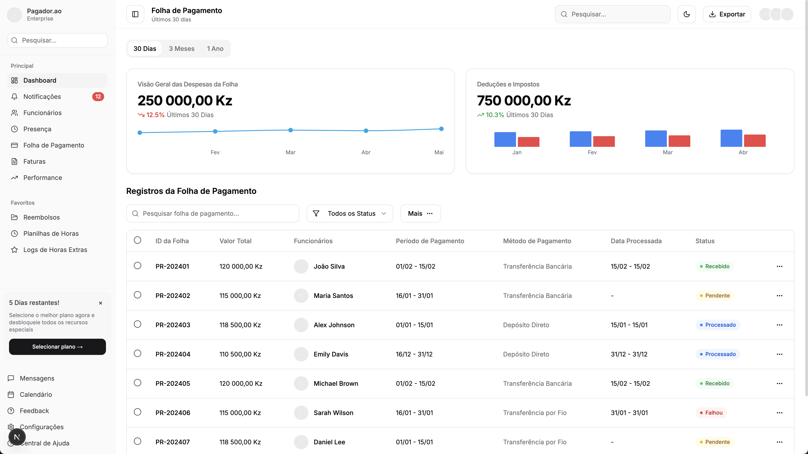
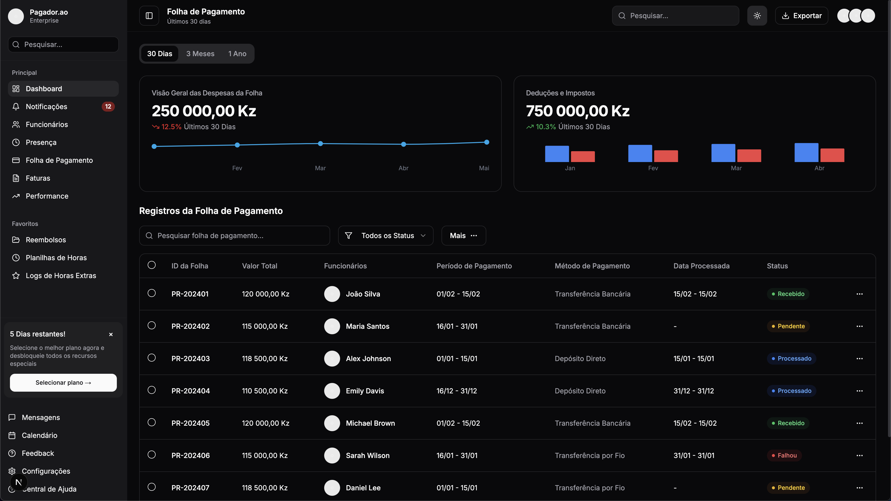

# pagador.ao

**pagador.ao** é uma plataforma premium de gestão de folha de pagamento e RH, desenvolvida para simplificar e automatizar o processamento salarial de empresas angolanas. Construído com foco em experiência do usuário, responsividade e performance, o sistema segue os princípios do [Apple Human Interface Guidelines (HIG)](https://developer.apple.com/design/human-interface-guidelines/), suportando tanto modo claro quanto escuro.

## Preview

### Light Mode



### Dark Mode



---

## Funcionalidades

- **Dashboard Gerencial** com gráficos e indicadores de despesas salariais
- **Gestão de Funcionários**
- **Calendário de Pagamentos e Presenças**
- **Controle de Períodos e Métodos de Pagamento**
- **Central de Mensagens e Notificações**
- **Formulários Dinâmicos e Validáveis**
- **Relatórios e Exportações de Dados**
- **Modo Claro e Escuro**
- **Design Responsivo** para desktop, tablet e mobile

---

## Documentação

A documentação funcional e técnica completa (módulos de RH, motor da folha, enquadramento legal angolano, modelo de dados, integrações e roteiro) está em [`docs/`](./docs/README.md).

---

## Tecnologias

- **Next.js 15** (App Router), **React 19**, **TypeScript**
- **Tailwind CSS** + **shadcn/ui** (Radix UI) + **Lucide Icons**
- **Axios** (camada HTTP) + **TanStack Query** (estado de servidor)
- **React Hook Form** + **Zod** (formulários e validação)
- **nuqs** (estado na URL) e **@bentoo/state-man** (estado global)
- **Recharts** (gráficos), **Sonner** (notificações), **next-themes** (modo claro/escuro)

O backend vive no projecto [`api.pagador.ao/`](../api.pagador.ao/) (NestJS). Este projecto é apenas a interface.

---

## Como executar o projecto

```bash
cp .env.example .env   # preencha as variáveis de ambiente
pnpm install
pnpm dev
```

Abra [http://localhost:3000](http://localhost:3000).

---

## Arquitectura

Arquitectura em camadas, organizada em fatias verticais (*vertical slices*) por domínio.

```
src/
├── actions/                # Server Actions do Next.js ("use server"); ver example.ts
├── app/                    # App Router — apenas rotas, sem lógica de negócio
│   ├── layout.tsx          # Layout raiz (fontes, metadata, AppProvider)
│   ├── (public)/           # Rotas sem autenticação (layout de autenticação)
│   │   ├── login/
│   │   │   ├── page.tsx
│   │   │   └── _components/    # Componentes usados só por esta página
│   │   └── register/
│   └── (private)/          # Rotas autenticadas (layout com sidebar)
│       ├── page.tsx        # dashboard
│       ├── employees/
│       ├── payroll/
│       └── ...
├── api/                    # Camada HTTP (independente do framework)
│   ├── lib/                # Instância Axios, interceptores, gestor de sessão, ApiError
│   ├── services/           # Uma classe de serviço por domínio
│   └── types/              # Tipos de pedido/resposta por domínio
├── components/
│   ├── ui/                 # Primitivas shadcn/ui
│   └── <domínio>/          # Componentes de domínio partilhados por várias rotas (charts/, payroll/)
├── config/                 # Validação do env (zod), URL da API, constantes da aplicação
├── hooks/                  # Hooks React partilhados
├── layouts/                # Shells de layout usados pelos layouts dos grupos de rotas
├── lib/                    # Utilitários (cn, formatação), cliente do TanStack Query
├── providers/              # AppProvider (tema, query, nuqs, toast)
├── queries/                # Hooks TanStack Query por domínio (query.ts / mutation.ts)
├── schemas/                # Esquemas Zod dos formulários por domínio
├── services/               # Serviços de interface (toast, …)
├── stores/                 # Estado global (@bentoo/state-man)
└── middleware.ts           # Middleware do Next.js (por agora sem efeito)
```

### Convenções

- **`actions/`** — Server Actions (`"use server"`) para mutações no servidor. Ver [src/actions/example.ts](src/actions/example.ts): acção validada com zod, pronta para `useActionState` / `<form action={...}>`.
- **`_components`** — componentes usados por uma única rota ficam numa pasta `_components` junto ao `page.tsx`. O sublinhado torna a pasta privada para o router (nunca é uma rota).
- **Grupos de rotas** — `(public)` e `(private)` têm cada um o seu layout.
- **Fatias verticais** — uma funcionalidade percorre `api/types` → `api/services` → `schemas` → `queries` → `_components` da rota. A fatia `auth` serve de referência.
- **Sem regras de negócio na interface** — cálculos, permissões e validações de negócio são da API; a interface apresenta e envia intenções.
- **Sessão** — os tokens ficam em cookies `HttpOnly` definidos pela API; o interceptor do Axios renova a sessão numa resposta 401 e repete o pedido.
- **Aliases** — `@/*` → `src/*`, `@api/*` → `src/api/*`, `@infra/*` → `src/*`.
- **Ambiente** — variáveis validadas com zod em [src/config/env.ts](src/config/env.ts); valores expostos ao cliente têm o prefixo `NEXT_PUBLIC_`.

---

## Scripts

| Comando      | Descrição                      |
| ------------ | ------------------------------ |
| `pnpm dev`   | Servidor de desenvolvimento    |
| `pnpm build` | Build de produção              |
| `pnpm start` | Servir a aplicação de produção |
| `pnpm lint`  | Executar o ESLint              |

---

## Idioma

Toda a interface do sistema está em **português (pt-BR/AO)**, focando na acessibilidade e compreensão para empresas e colaboradores locais.

---

## Contato

Caso tenha sugestões, feedback ou queira contribuir, entre em contato comigo pelas redes sociais:

- [Facebook](https://www.facebook.com/ikitumba)
- [Instagram](https://www.instagram.com/albertokitumba/)
- [Twitter (X)](https://x.com/TheKitumba)
- [LinkedIn](https://www.linkedin.com/in/albertokitumba/)

---

**pagador.ao** — Feito com ❤️ para empresas que valorizam eficiência e transparência.
